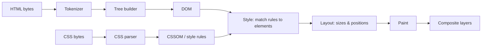

# 01 · How Browsers Turn HTML & CSS into Pixels

HTML and CSS are not programming languages in the usual sense. You don't write
instructions that run top to bottom; you write **descriptions**. HTML describes what a
piece of content *is* — a heading, a list, a form field, a navigation block. CSS
describes how things that match certain patterns should *look*. The browser does
everything else: it reads both, works out a layout for whatever screen it happens to be
on, and draws it.

That division of labour is why the same page can work on a phone, a 4K monitor, a screen
reader that never draws anything, and a search engine crawler. It's also why so many
HTML/CSS problems feel mysterious: you're not controlling the browser, you're giving it
information and letting it decide. This course is largely about learning what the browser
does with that information.

## Your first page

Create a folder called `html-css-course`, and inside it a file called `index.html`:

```html title="index.html"
<!doctype html>
<html lang="en">
  <head>
    <meta charset="utf-8">
    <meta name="viewport" content="width=device-width, initial-scale=1">
    <title>My first page</title>
    <link rel="stylesheet" href="styles.css">
  </head>
  <body>
    <h1>Hello, web</h1>
    <p>This paragraph is <em>content</em>. The browser decides how to lay it out.</p>
  </body>
</html>
```

And next to it, `styles.css`:

```css title="styles.css"
body {
  font-family: system-ui, sans-serif;
  max-width: 40rem;
  margin: 2rem auto;
  padding: 0 1rem;
  line-height: 1.5;
}

h1 {
  color: #b3401a;
}
```

Double-click `index.html` to open it in a browser. You have a working web page: no
build step, no server, no dependencies. Every line of the HTML is explained in the next
lesson; for now, notice the split. `index.html` says "there is a top-level heading and a
paragraph with an emphasised word." `styles.css` says "headings of level 1 are this
colour; the body is at most 40rem wide and centred."

### A local server (optional but useful)

Opening files directly (`file://` URLs) works for everything in Level 1. Some later
features — fetching JSON, certain font and module loading rules — behave differently on
`file://`, so it's worth knowing how to serve a folder over HTTP. Any static server
works. If you have Python installed:

```bash
cd html-css-course
python3 -m http.server 8000
```

Then visit `http://localhost:8000/`. If you use VS Code, the "Live Server" style
extensions do the same thing and reload the page when you save.

## Elements, tags and attributes

HTML is made of **elements**. Most elements are written as an opening tag, content and
a closing tag:

```html
<a href="https://example.com/" title="Example site">a link</a>
```

- `<a ...>` is the opening tag; `a` is the element name.
- `href="https://example.com/"` and `title="Example site"` are **attributes** — named
  settings for that element.
- `a link` is the content.
- `</a>` is the closing tag.

Some elements have no content and therefore no closing tag. These are called **void
elements**: ``, `<input>`, `<br>`, `<meta>`, `<link>`, `<hr>` and a few others.
You may see them written `` with a trailing slash; in HTML that slash is
allowed but ignored. It doesn't "close" anything.

Elements nest. The paragraph above contains text and an `<em>` element, which contains
more text. That nesting forms a tree, and the tree is the thing the browser actually
works with.

## Developer tools: your most important instrument

Every desktop browser ships developer tools. Right-click any part of a page and choose
**Inspect**. You'll see:

- The **Elements** (Chrome, Edge) or **Inspector** (Firefox, Safari) panel, showing the
  *current* document tree — not the file you wrote, but what the browser built from it.
- A **Styles** pane listing every CSS rule that applies to the selected element, with
  overridden declarations struck through.
- A **Computed** pane showing the final value of every property and a box-model diagram.
- A **Console** where you can run JavaScript against the page.

Keep devtools open while you work through this course. Almost every "why does it look
like that?" question is answered by selecting the element and reading the Styles and
Computed panes.

## Worked example: the browser repairs your mistakes

HTML parsing is famously forgiving. The HTML standard doesn't just say what valid HTML
looks like; it specifies, step by step, how every browser must handle *invalid* HTML.
That's why broken markup still renders — and why it renders the same (broken) way in
every modern browser.

We fed this deliberately sloppy markup to headless Chromium 153 and asked for the
resulting `document.body.innerHTML`:

```html
<p>One<p>Two<div>Three</div><table><tr><td>Cell</td></tr></table><b>bold <i>both</b> italic?</i>
```

What the browser built:

```text
<p>One</p><p>Two</p><div>Three</div><table><tbody><tr><td>Cell</td></tr></tbody></table><b>bold <i>both</i></b><i> italic?</i>
```

Four separate repairs happened:

1. The second `<p>` implicitly **closed** the first — paragraphs can't nest.
2. `<div>` also closed the open paragraph, because a `<p>` can only contain "phrasing"
   content (text-level elements), not a block like `<div>`.
3. A `<tbody>` was **inserted** around the table row. Every table row in the DOM lives
   inside a row group, even if you never wrote one. (This matters for CSS: a selector
   like `table > tr` matches nothing.)
4. The mis-nested `<b><i></b></i>` was split. The browser closed `<i>` inside `<b>` and
   then re-opened a *new* `<i>` for the rest. This is the "adoption agency algorithm" —
   it has an official name because it's that intricate.

The lesson isn't "write sloppy HTML and let the browser fix it." It's that **the DOM is
the truth, not your source file.** When a style or script doesn't apply the way you
expect, compare what you wrote with what the Elements panel shows.

## How It Actually Works

When you load a page, the browser runs roughly this pipeline:



1. **Decode.** The bytes are decoded to characters using the declared encoding (that's
   what `<meta charset="utf-8">` is for).
2. **Tokenize and build the tree.** The tokenizer turns characters into tokens (start
   tag, end tag, text, comment); the tree builder consumes tokens and maintains a stack
   of open elements. The repairs in the example above all happen here: when a token
   arrives that can't legally go where the stack says it would, the spec says which
   elements to close or insert.
3. **Fetch subresources.** A preload scanner runs ahead of the parser looking for
   `<link rel="stylesheet">`, `<script src>` and `` so downloads start early.
4. **Build style rules.** CSS is parsed into rules. Stylesheets are *render-blocking* by
   default: the browser won't paint content until the CSS in the `<head>` has loaded,
   because painting unstyled content and then restyling it would flash.
5. **Style.** For every element, the browser finds all matching rules and resolves
   conflicts with the cascade (lesson 08) to get a *computed value* for every property.
6. **Layout.** It works out the size and position of every box — which depends on the
   viewport width, the fonts, the images' dimensions, and the content itself.
7. **Paint and composite.** Boxes are drawn into layers, and layers are combined on the
   GPU into the final frame.

Classic `<script>` elements interrupt step 2: the parser stops, runs the script, then
continues. We observed this directly — a script placed *before* two paragraphs logged
`inline script sees 0 paragraphs`, and one placed after them logged `later script sees 2`.
That's why scripts that touch the page are usually put at the end of `<body>` or marked
`defer`.

One more thing the parser decides early: **rendering mode**. With `<!doctype html>` at
the top, Chromium reported `document.compatMode` as `CSS1Compat` (standards mode).
Remove the doctype and the same query returned `BackCompat` — "quirks mode", which
emulates 1990s browser bugs such as tables not inheriting font sizes and different box
sizing for some elements. Always start with the doctype.

## Common mistakes

- **Leaving out `<!doctype html>`.** The page will mostly look fine, which is exactly
  why it's dangerous — a handful of layout rules silently change.
- **Treating HTML as presentation.** Choosing `<h3>` because it "looks the right size"
  or `<blockquote>` because it indents. Pick elements for meaning; change looks with CSS.
- **Trusting your source file over devtools.** If a selector doesn't match, check the
  live DOM — the element may have been moved, closed early or wrapped.
- **Expecting `/>` to close a non-void element.** `<div />` is just `<div>`; everything
  after it becomes its child until something closes it.
- **Saving the file in an encoding other than UTF-8** while declaring UTF-8 (or declaring
  nothing). Accented letters and symbols turn into garbage characters.

## Exercise

1. Build the two-file page above. Change the `h1` colour and the `max-width`, reload,
   and confirm the change.
2. Open devtools, select the `<em>` element, and find its `font-style` in the Computed
   pane. Where does that value come from? (Look for "user agent stylesheet".)
3. Paste the sloppy markup from the worked example into a new file and compare the
   Elements panel with your source. Then write a correct version that produces the same
   DOM *without* relying on any repair.
4. Delete the doctype line, open the console and run `document.compatMode`. Put it back
   and run it again.
5. Add `<script>console.log(document.querySelectorAll('p').length)</script>` once in the
   `<head>` and once at the end of `<body>`. Explain the two numbers you see.
